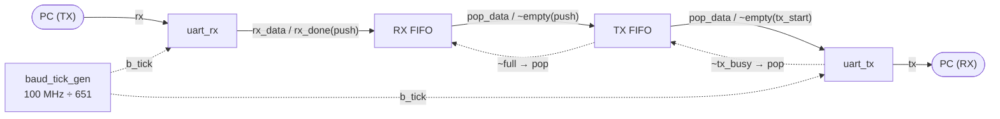

# UART (RX · TX) + FIFO Loopback

Verilog로 UART 수신기·송신기와 FIFO를 직접 설계하고, 이를 **루프백(loopback)** 구조로 묶어 PC → FPGA → PC 전체 데이터 경로를 검증한 KDT 미니 프로젝트입니다.
PC에서 보낸 바이트가 `uart_rx → RX FIFO → TX FIFO → uart_tx`를 거쳐 그대로 PC로 되돌아옵니다.

- **보드**: Basys 3 (AMD Xilinx Artix-7), 100 MHz
- **언어 · 툴**: Verilog HDL, Vivado
- **UART 테스트 프로그램**: ComportMaster

<br>

## 📌 결과 요약

| 항목 | 결과 |
|---|---|
| 단일 바이트 루프백 (0x55) | RX → FIFO → TX 전 경로의 상태 전이 · 타이밍 확인, **pass** |
| 랜덤 8bit 값 256회 루프백 | **256 / 256 pass** |
| 송신 보레이트 오차 허용 범위 | **−4.8% ~ +6.2%** 에서 감지 위상과 무관하게 100% 정상 수신 |
| 실제 보드 동작 | ComportMaster로 송수신 확인 |

> 일반적인 USB-UART 브리지의 보레이트 오차(±2% 이내) 대비 충분한 마진을 확보했습니다.

<br>

## ⚙️ 설계 사양

| 항목 | 값 |
|---|---|
| 시스템 클럭 | 100 MHz |
| 통신 형식 | 9600 bps, **8N1** (Data 8bit · Parity 없음 · Stop 1bit) |
| 오버샘플링 | 16배, 651 분주 (`b_tick` 주기 6.51 µs, 오차 약 +0.006%) |
| FIFO | 깊이 4 × 8bit, RX · TX 각 1개 (최대 8바이트 버퍼링) |
| 리셋 | 비동기, Active-High |

<br>

## 🧩 블록 다이어그램



| 신호 연결 | 설명 |
|---|---|
| `uart_rx.rx_done → RX FIFO.push` | 1바이트 수신 완료 시 RX FIFO에 저장 |
| `~TX FIFO.full → RX FIFO.pop` | TX FIFO에 자리가 있으면 RX FIFO에서 꺼냄 |
| `~RX FIFO.empty → TX FIFO.push` | RX FIFO에 데이터가 있으면 TX FIFO로 전달 |
| `~TX FIFO.empty → uart_tx.tx_start` | 보낼 데이터가 있으면 송신 시작 |
| `~uart_tx.tx_busy → TX FIFO.pop` | 송신기가 쉬고 있을 때 다음 데이터를 꺼냄 |

<br>

## 📂 프로젝트 구조

```
.
├── 설계 코드/
│   ├── uart.v          # Top: uart_fifo_loopback, baud_tick_gen
│   ├── uart_rx.v       # UART 수신기 (FSM, 16x 오버샘플링)
│   ├── uart_tx.v       # UART 송신기 (FSM)
│   └── fifo.v          # FIFO (register_file + control_unit)
├── simulation_code/
│   ├── tb_uart_fifo.v  # S1 · S2: 랜덤 256회 루프백 검증 (tb_uart)
│   └── tb_uart_fifo_.v # S3: 보레이트 오차 허용 범위 검증 (tb_uart_nonpass)
├── constraint_code/
│   └── Basys-3-Master.xdc  # Basys 3 핀 제약 (clk, rst, rx, tx)
├── 조수영_UART_FIFO_loopback.pptx   # 발표 자료 (파형 · 결과 · 고찰)
├── 조수영_UART_FIFO_loopback.pdf    # 발표 자료 PDF
└── README.md
```

<br>

## 🔍 모듈 설명

### `baud_tick_gen`
100 MHz 클럭을 `F_COUNT = 100_000_000 / (9600 × 16) = 651`로 분주해 **1비트당 16번** 1클럭 폭의 `b_tick` 펄스를 생성합니다.

### `uart_rx` — 수신기 FSM

| 상태 | 동작 |
|---|---|
| `IDLE` (00) | `b_tick` 시점에 `rx == 0`(start bit) 감지 시 `START`로 이동 |
| `START` (01) | 8 tick(½ bit) 대기 → 이후 샘플링이 **비트 중앙**에서 일어나도록 위상 정렬 |
| `DATA` (10) | 16 tick마다 `rx`를 샘플링해 `{rx, data[7:1]}`로 우시프트 (LSB first), 8비트 수신 후 `STOP` |
| `STOP` (11) | 16 tick 후 `rx_done = 1` 출력, `IDLE` 복귀 |

### `uart_tx` — 송신기 FSM

| 상태 | 동작 |
|---|---|
| `IDLE` (00) | `tx = 1`. `tx_start`가 들어오면 `tx_data`를 래치하고 `START`로 이동 |
| `START` (01) | `tx = 0`, `tx_busy = 1`, 16 tick 유지 |
| `DATA` (10) | `tx = data_reg[0]` 출력, 16 tick마다 우시프트, 8비트 송신 후 `STOP` |
| `STOP` (11) | `tx = 1`, 16 tick 유지 후 `IDLE` 복귀 (`tx_busy = 0`) |

### `fifo` — 원형 버퍼
- **`register_file`**: 깊이 4 × 8bit 메모리. 쓰기는 클럭 동기(`we = ~full & push`), 읽기는 조합 출력(`pop_data = mem[rptr]`)
- **`control_unit`**: 2bit 포인터 `wptr` / `rptr`와 `full` / `empty` 플래그 관리

| `{push, pop}` | 동작 |
|---|---|
| `00` | 변화 없음 |
| `10` | full이 아니면 `wptr + 1`, 포인터가 같아지면 `full = 1` |
| `01` | empty가 아니면 `rptr + 1`, 포인터가 같아지면 `empty = 1` |
| `11` | full이면 읽기만, empty면 쓰기만, 그 외엔 양쪽 포인터 동시 증가 |

파라미터(`DEPTH`, `D_BIT_WIDTH`)로 깊이와 데이터 폭을 변경할 수 있습니다.

<br>

## 🧪 시뮬레이션

공통 조건: clk 100 MHz (`#5` 토글), 9600 bps 8N1, 1 bit = 104,160 ns

### S1 · S2 — `tb_uart_fifo.v` (`tb_uart`)
- `sender_uart` 태스크로 DUT의 `rx`에 프레임을 넣고, `receive_uart` 태스크로 `tx`를 비트 중앙에서 읽어 복원
- `score_board` 태스크로 `expected_data`와 `result_data`를 비교해 pass / fail 집계
- `$random % 256` 랜덤 값 **256회** 반복 → **256 pass / 0 fail**
- 단일 바이트 시나리오(S1)는 `expected_data = 8'b01010101`로 바꿔 상태 전이 · 16 tick 간격 · 시프트 · FIFO 전달을 파형으로 확인

### S3 — `tb_uart_fifo_.v` (`tb_uart_nonpass`)
- 송신 비트 주기를 `bit_period = BAUD_BIT_PERIOD × (1 + skew)`로 바꿔 **보레이트 오차 허용 범위** 측정
- `for (j = ...)` 루프 범위를 바꾸며 skew를 0.1% 단위로 스윕하고, 각 skew마다 256회 pass / fail 집계
- 송신과 수신을 `fork ... join`으로 병렬 수행

| 조건 | + 한계 | − 한계 |
|---|---|---|
| 감지 지연 고정 (위상 고정) | +6.9% | −4.8% |
| 감지 지연 랜덤 (0 ~ 1 tick) | **+6.2%** | **−4.8%** |

### 실행 방법 (Vivado)
1. 새 프로젝트를 만들고 `설계 코드/` 의 `.v` 파일을 **Design Sources**로 추가
2. `simulation_code/` 의 테스트벤치 중 하나를 **Simulation Sources**로 추가하고 Top으로 지정
   (두 테스트벤치 모두 DUT로 `uart_fifo_loopback`을 사용)
3. **Run Behavioral Simulation** 실행 후 `Run All` → Tcl 콘솔에서 report 확인

### 보드 실행
`constraint_code/Basys-3-Master.xdc` 의 핀 매핑은 다음과 같습니다.

| 포트 | 핀 | Basys 3 연결 |
|---|---|---|
| `clk` | W5 | 100 MHz 온보드 클럭 (period 10 ns) |
| `rst` | U18 | 중앙 버튼 BTNC (누르면 리셋) |
| `rx` | B18 | USB-UART RX (PC → FPGA) |
| `tx` | A18 | USB-UART TX (FPGA → PC) |

1. `constraint_code/Basys-3-Master.xdc` 를 **Constraints**로 추가
2. Synthesis → Implementation → Generate Bitstream 후 Hardware Manager로 보드에 다운로드
3. ComportMaster 등 시리얼 터미널을 **9600 bps, 8N1**로 열고 문자를 보내면 같은 문자가 되돌아옴

<br>

## 💡 고찰

**1. 감지 지연이 실제 샘플링 위치를 결정한다**
수신기는 `IDLE`에서 매 클럭이 아니라 `b_tick`마다만 `rx`를 확인하므로, start bit 감지에 0 ~ 1 tick의 지연이 생깁니다. 샘플링은 감지 시점부터 세기 때문에 실제 위치는 비트 중앙(50%)이 아니라 **50 ~ 56%** 지점입니다. 16배 오버샘플링은 이 오차를 1/16 bit 이내로 줄이는 방법입니다.

**2. 오차 허용 범위는 비대칭이다**
샘플링 위치가 중앙보다 약간 뒤에 있으므로, 느린 송신(+6.2%)을 빠른 송신(−4.8%)보다 더 잘 견딥니다. 시뮬레이션의 첫 fail 지점(+6.3%, −4.9%)이 D7 샘플링 위치로 계산한 이론 한계(+6.25%, −4.86%)와 일치했습니다.

**3. 테스트벤치 구조가 검증 결과를 바꾼다**
1 bit가 16 tick의 정수배라서 송신 시작이 항상 tick 직후에 고정되면, 모든 바이트가 감지 지연 ≈ 1 tick 조건으로만 시험되어 + 한계가 약 7%로 **과대평가**됩니다. 송신 시작에 0 ~ 1 tick 랜덤 지연을 넣어 위상을 분산시킨 뒤에야 최악 조건의 한계(+6.2%)를 확인할 수 있었습니다. 테스트벤치가 실제 환경을 얼마나 재현하는지가 중요하다는 점을 배웠습니다.

<br>

## 👤 Author
- **조수영** ([@ccocco33](https://github.com/ccocco33))